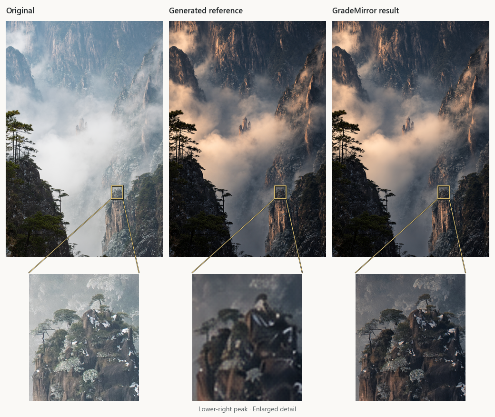
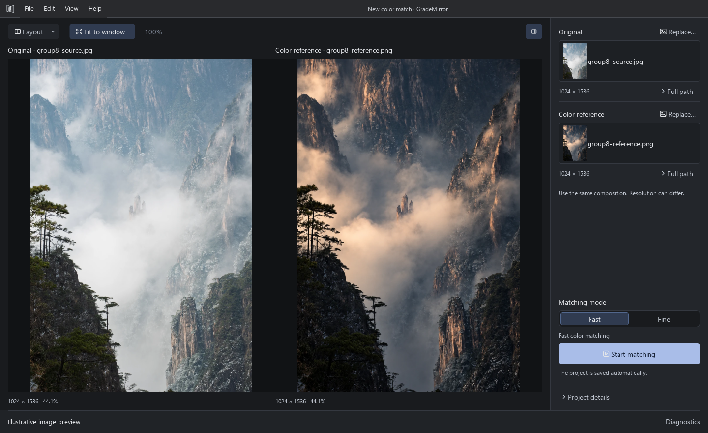
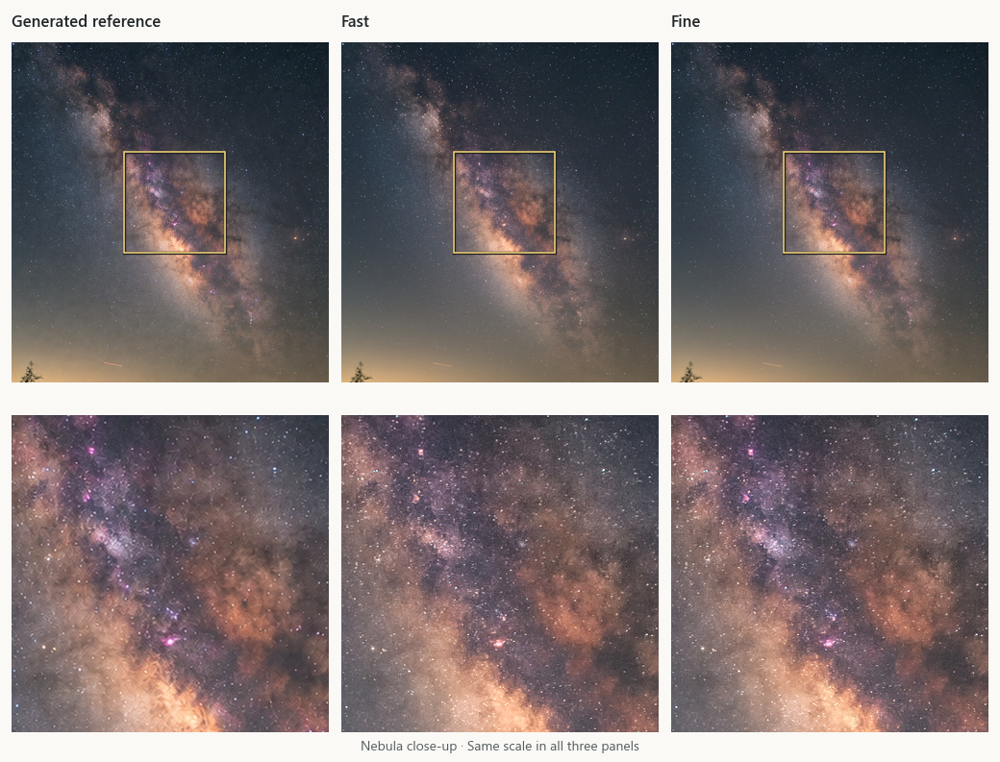
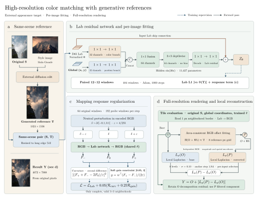

English · <a href="README.zh-CN.md" lang="zh-CN">简体中文</a>

<h1 align="center"></h1>

<strong>Mirror an AI-generated grade back onto your original photograph.</strong>

  <strong>v0.1.0 first preview</strong> · Windows x64 · Free download

  <strong><a href="https://pixelcraft2026.github.io/GradeMirror/grademirror.html">Website</a> · <a href="https://pixelcraft2026.github.io/GradeMirror/">Research</a></strong>

  <a href="#download-and-launch">Download and launch</a> ·
  <a href="#make-your-first-match">Quick start</a> ·
  <a href="#fast-and-fine">Fast and Fine</a> ·
  <a href="#formats-and-devices">Formats and devices</a> ·
  <a href="#research-and-algorithm">Research and algorithm</a> ·
  <a href="#source-license-and-feedback">Source, license and feedback</a> ·
  <a href="#support-grademirror">Support GradeMirror</a>

GradeMirror is a local Windows tool for matching a photograph to a graded reference of the same scene. It learns the change in color and local tone from the two images, then renders the grade from the original pixels at the original dimensions. Use a reference made in an external image generator or a hand-graded proof. With the image pair ready, matching and export run locally.

Image generation models have shown **extraordinary potential for photographic color grading**. They offer a more powerful understanding of scene semantics than almost all traditional image-processing algorithms, enabling them to consider subjects, materials and lighting when creating color and tonal changes across different regions and coordinating the transitions between them. Compared with a large language model applying curves, color wheels and masks one adjustment at a time, they can present a complete set of local changes in one draft, without first breaking the image into regions and specifying each parameter. Generated images, however, can have limited resolution or redrawn texture and detail, which can hinder their use in professional photographic post-production.

I developed GradeMirror to transfer an image generation model's grade to the original photograph, enabling photographers to apply its powerful color-grading capabilities while losing almost none of the original image's resolution or texture detail.

## See the grade

The top row shows web previews of the **4672 × 7008 original, 1024 × 1536 generated reference, and 4672 × 7008 graded result**. The lines connect the marked area on the lower-right peak to three close-ups shown at the same scale. Compare the pine branches and rock texture, and see how the tones from the reference carry over to the original. This figure uses saved research results.

### Prepare a reference

**The misty peaks example uses three images.** The middle column above is the draft generated by ChatGPT for the same scene.

1. **The original establishes the scene.** Give ChatGPT the misty peaks photograph as the first image. It defines the framing, viewpoint, ridgeline, and pine branches to preserve. It also supplies the pixels GradeMirror uses for the final render.
2. **A different photograph provides the color direction.** The second image is a Peruvian mountain photograph by **Max Rive**, from his [Peru gallery](https://maxrivephotography.com/pages/peru). In the same request, ask ChatGPT to keep the scene in the first image and use the second photograph as a guide to color, light and dark tones, and the balance of warm and cool areas.
3. **The generated draft is GradeMirror's color reference.** Load the misty peaks photograph as **Original** and the ChatGPT draft of the same scene as **Color Reference**. GradeMirror learns the changes in color and local tone from that pair, then applies the grade to the original pixels.

Here is an example prompt for ChatGPT:

> Use the first image, the misty peaks photograph, as the base. Keep its framing, crop, viewpoint, and subject positions. Borrow the color and tone of the second photograph. Warm the lit rock faces slightly and keep both warm and cool tones in the mist. Preserve the shape and detail of the ridgeline, pine branches, and rock faces, with natural tonal transitions.

Switch between the original and the draft to check that the ridgeline, prominent peaks, pine branches, and crop edges line up. A lower-resolution draft can work well when the framing and features match closely. If you already have a hand-graded version of the same photograph, you can use it directly as the color reference.

**Generate the reference with Doubao.** The same workflow also works with Doubao image generation. A Doubao watermark has no noticeable effect on the overall grade in Fast mode. Fine mode uses local color differences from the reference, so the watermark interferes with the correction in that area. Use a watermark-free draft of the same scene for Fine mode.

## Download and launch

The GradeMirror v0.1.0 preview is now available for Windows x64.

| Device | Download | Launch |
|---|---|---|
| CPU | [CPU portable edition](https://github.com/PixelCraft2026/GradeMirror/releases/download/v0.1.0/GradeMirror-0.1.0-Windows-CPU.zip) | Extract the whole ZIP and open `GradeMirror.exe` inside `GradeMirror-CPU`. |
| Compatible NVIDIA GPU | [GPU part 1](https://github.com/PixelCraft2026/GradeMirror/releases/download/v0.1.0/GradeMirror-0.1.0-Windows-GPU-1.zip) + [GPU part 2](https://github.com/PixelCraft2026/GradeMirror/releases/download/v0.1.0/GradeMirror-0.1.0-Windows-GPU-2.zip) | Use **Extract All** on both ZIPs, choose the same parent directory both times, then open `GradeMirror.exe` from the resulting `GradeMirror-GPU` folder. |

Both editions include their runtimes. The GPU edition also requires a compatible NVIDIA driver. Review the applicable component terms before downloading. [Download guide](docs/DOWNLOAD.en.md) · [Release notes and SHA-256](docs/RELEASE-v0.1.0.en.md) · [Microsoft component terms](docs/MSVC-RECIPIENT-TERMS.en.md) · [NVIDIA component terms](docs/NVIDIA-RECIPIENT-TERMS.en.md)

### Choosing CPU or GPU

Choose the CPU edition if you lack a compatible NVIDIA GPU or only process photos occasionally and can allow more time. Choose the GPU edition if you have a compatible NVIDIA card and regularly work with high-resolution originals or use Fine mode.

This is a single comparison from development on the same machine and the same **24 MP** photograph (4000 × 6000), using a **Core i5-12600K (4 threads)** for the CPU route and an **RTX 3070 Ti (8 GB)** for the GPU route.

| Operation | CPU | NVIDIA GPU |
|---|---:|---:|
| First Fast match | About 9 min 36 s | About 1 min 10 s |
| Fast followed by Fine (total for both steps) | About 24 min 05 s | About 2 min 43 s |

The measurements include processing, previews, JPEG export, and readback. The second row adds the measured times for the separate Fast and Fine operations. Actual times vary with image dimensions, hardware, and system load.

## Make your first match

Use your own original and a graded reference of the same scene. Each image must have a long edge of at least 512 pixels.

1. Drop your images into **Original** and **Color Reference**, then start in **Fast** mode.
2. Compare rock and mist tones in the full view, then use the linked 1:1 view to inspect the same ridgeline and rock texture. Adjust the grade strength as needed. If you still see local color differences, a compatible Fast project can continue to Fine processing.
3. Save a copy at the original dimensions, file format, and bit depth. Keep the `.grademirror` project if you want to render the grade again later.

This preview.50 workspace illustration shows the two image roles after import.

## Fast and Fine

| Mode | When to use it | What it does |
|---|---|---|
| Fast | Check the grade, compare drafts, or export when the match already looks right | Learns the transform from a pair resized to a 512-pixel long edge. It uses Lab color, position in the full image, and a 3 × 3 neighborhood, then renders at the original dimensions. Sky and rock can receive different adjustments even when they start with similar colors. |
| Fine | Correct remaining local color differences after a good Fast match | Starts from the Fast result, fits a smooth field of local RGB offsets at reference resolution, and uses an edge-aware difference to carry the correction to full resolution. Inspect ridgelines, mist boundaries, and small highlights before choosing which result to export. |

**Milky Way example.** The top row marks an area near the galactic core. The bottom row enlarges the same nebula region at the same scale in all three panels. Compare the magenta highlights, the warmer cloud to the right, and the dust lanes between them. The center and right show the saved base grade and that same grade with local correction and difference reconstruction, corresponding to the Fast and Fine research stages.

## Formats and devices

| Format | Supported bit depth per channel |
|---|---|
| JPEG / JPG, WebP, BMP | 8-bit RGB |
| PNG, TIFF | 8-bit or 16-bit RGB |

- **Color management.** GradeMirror works in sRGB and interprets untagged RGB images as sRGB. Convert Adobe RGB, Display P3, and other profiles to sRGB first. Convert transparent images to opaque RGB. For RAW, develop the photo first and consider exporting a 16-bit sRGB TIFF.
- **Export.** Output follows the original's pixel dimensions, format, and bit depth. The processed frame is the main image. ICC and photographic EXIF retention depend on the format and the input file. Open an exported file and check its metadata if the delivery depends on it.
- **Large photos.** The input size check has a 210-megapixel ceiling. Actual processing depends on dimensions, mode, RAM, Windows commit headroom, and available VRAM. In a preview.26 development run on Windows 10 with an RTX 3070 Ti (8 GB), saved parameters and local correction coefficients were used to render, export, and read back a full-size 102 MP Fujifilm TIFF (11648 × 8736, 16 bits per channel). On Windows 11 build 26200, both preview.50 editions completed a small Fast job using the CPU. Native CUDA on that OS remains unverified.

The **edition** determines which runtimes ship with the app. The **compute route** determines how each job runs. CPU can handle Fast and Fine. Auto prefers an eligible NVIDIA route. If the available resources fall short, GradeMirror can ask you to recheck them and offer the CPU route when it is eligible. For supported Fine jobs, you can select Hybrid explicitly to render with NVIDIA and run Fine post-processing on the CPU. Saved recipes also need a compatible route for replay.

Open **Help → Device and runtime status** (Ctrl+Alt+R) for device information. The progress bar shows the current stage and displays an estimated time range once enough data is available. [Download guide](docs/DOWNLOAD.en.md) · [Known issues](docs/KNOWN-ISSUES.en.md)

## Projects and the CLI

A `.grademirror` project records input identities and a grading recipe. While the result is in memory, you can switch views, adjust strength, and export again using the completed result. After the result is released, reopen a compatible project to render from the saved recipe. If you moved the original file, locate it again through **Help** and GradeMirror will check its identity.

Open PowerShell in the application directory. Replace the example image paths with paths to your own files. With a JPEG original, these commands create a Fast project and export a JPEG at 75% strength.

~~~powershell
.\GradeMirror-CLI.exe doctor --json

.\GradeMirror-CLI.exe fit --source ".\photos\original.jpg" --reference ".\photos\reference.webp" `
  --mode fast --backend cpu --out ".\matched.grademirror" `
  --export ".\matched.jpg" --alpha 0.75 --json
~~~

Use `fit` to learn a new grade and `replay` to render from an existing recipe. Automation can also use `plan` to inspect the compute route, and the `result` subcommands to preview, export, or release a result held in memory. Use `--help` on a command for its options.

The CLI lets an LLM coordinate the whole workflow. **Choose an original and a style reference, call an external generator to produce a same-scene draft, then call GradeMirror to apply the grade to the original and export it.** Each stage has inputs and results you can inspect. A GradeMirror color-grading Skill is in development.

## Research and algorithm

The paper studies pairs with closely matching compositions. A lower-resolution draft supplies the target color and tone, and the high-resolution original supplies the image data for the final render. The development comparisons included global color mapping, BGU, SA-LUT, and SM-LUT. In cases with strong local grading, [INRetouch](https://arxiv.org/abs/2412.03848) with a **3 × 3 neighborhood** was among the better-looking methods. It can also fit a single image pair and evaluate the transform at the original resolution. The paper takes its joint use of color, position, and neighborhood as a starting point and develops three stages in an independent implementation.

Open the workflow diagram and method notes

1. **Lab residual modeling.** On a pair resized to a 512-pixel long edge, the network encodes color and whole-image coordinates separately and takes in neighboring features through a 3 × 3 depthwise convolution. The color input, the predicted residual, and the primary loss use normalized D65 CIELAB. The predicted residual is added to the input Lab color, then converted back to RGB. At full resolution, tiles retain whole-image coordinates and read original pixels across tile boundaries for neighborhood context.
2. **Mapping response regularization.** During fitting, small common offsets are applied to all three encoded RGB channels of selected windows. Three perturbation samples give finite differences that penalize changes in slope and gains that fall outside the chosen range. This training constraint aims to improve transitions between nearby input colors.
3. **Local color correction and difference reconstruction.** Fine processing starts with the full-resolution base grade `O`. It fits a smoothly varying, bilinear field of additive RGB offsets at the reference scale, using the same area weights to aggregate the base grade and the candidate field. It applies the field at full resolution to obtain `P`. A local Laplacian filter `L` is applied separately to `O` and `P`, giving `Y = O + [L(P) − L(O)]`. This combines the filtered component of the corrected image with the decomposition residual of the base grade.

Of the 15 cases used in development and method selection, six have complete post-processing comparisons. Local correction alone lowered RGB mean absolute error at the reference scale by **5.63%–15.45%** relative to the base grade. Difference reconstruction raised the error in all six cases compared with local correction alone, with error still **3.30%–9.75%** below the base grade. The references were used for fitting, so these numbers measure color agreement with those drafts on the development cases. Texture, stars, and edges are best assessed by comparing the same areas in the original and the result.

## Outlook

In a small set of preliminary tests on tasks such as color matching and white balance correction from a single JPEG, image2.6 and GradeMirror produced better results than the state-of-the-art methods included in the comparisons. These early results show the potential of this workflow for a wider range of image processing tasks. The research is ongoing, and we'll share more details once we have results from the next stage. Most of the credit goes to image2.6, which creates the reference for the color grade or white balance correction. GradeMirror adds one final step. It transfers the reference's color and tone back to the original and renders at the original resolution with the original texture, addressing a limitation of AI image generation. In the near future, this division of labor between generative models and specialized algorithms could change how we approach many image processing problems.

## Source, license and feedback

> [!IMPORTANT]
> GradeMirror is an open project in preview; behavior and interfaces may change as the project develops.
>
> If the project is useful to you, consider crediting GradeMirror when sharing work built with it, citing the repository in academic work, or starring the repository and sharing your experience.
>
> GradeMirror's project-owned code is available under **AGPL-3.0-only**. Please follow the [AGPL license terms](LICENSE) when using, modifying or distributing it, and pay particular attention to the following:
>
> - **Do not distribute an AGPL-covered work as a closed-source whole.** If GradeMirror code is combined with other code into a work covered by the AGPL, distributing that work requires licensing the whole under the AGPL and providing the corresponding source as required.
> - **Do not omit applicable source and license obligations.** When distributing GradeMirror or a modified version, retain the required copyright and license notices and provide the corresponding source in a manner permitted by the license. Modified versions must also identify changes as required.
> - **Do not withhold the corresponding source from remote network users of a modified version.** When users interact with a modified program remotely over a network, AGPL section 13 requires offering them an opportunity to obtain the corresponding source for that version.
>
> This is a summary; the complete conditions are in the [AGPL license](LICENSE). If you need different license terms, please open an issue to discuss separate licensing for rights the project owner can grant. Third-party components and brand assets have their own applicable terms; see [NOTICE](NOTICE) and [third-party materials](docs/THIRD-PARTY.en.md).

The application code lives in [`engineering/source/src/grademirror/`](engineering/source/src/grademirror/). The [build guide](docs/BUILD.en.md) covers pinned dependencies and packaging. The [complete source and third-party materials ZIP](https://github.com/PixelCraft2026/GradeMirror/releases/download/v0.1.0/GradeMirror-0.1.0-Source-and-ThirdParty.zip) includes the matching engineering source, third-party source archives, notices and instructions for building the Qt libraries.

When reporting a problem, include the app version, CPU or GPU edition, Windows version and steps to reproduce it. You can export a diagnostic log from **Help**. Remove private paths or photographs before sharing. [GitHub Issues](https://github.com/PixelCraft2026/GradeMirror/issues)

## Support GradeMirror

If GradeMirror helps with your photo editing and you’d like to support its continued development, I’d really appreciate a [coffee](https://buymeacoffee.com/pixelcraft2026).
