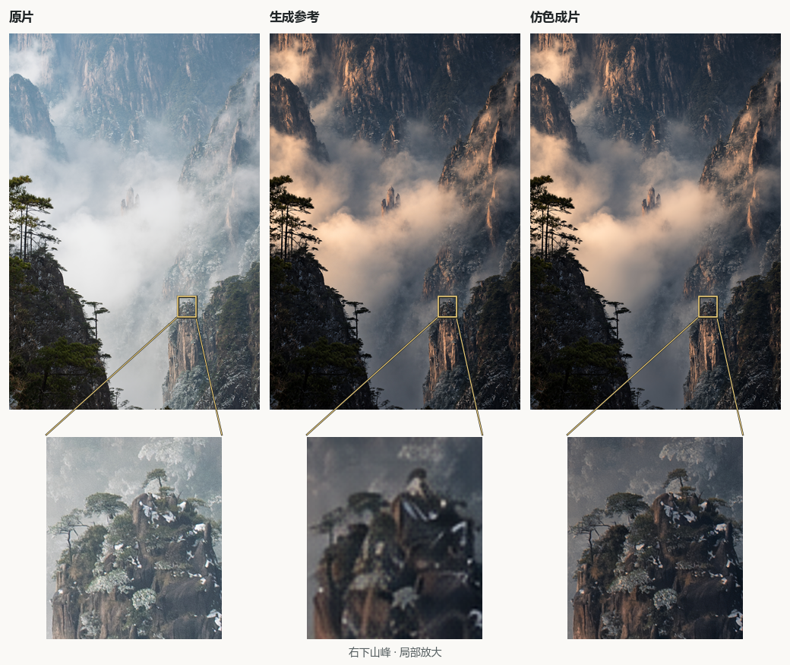
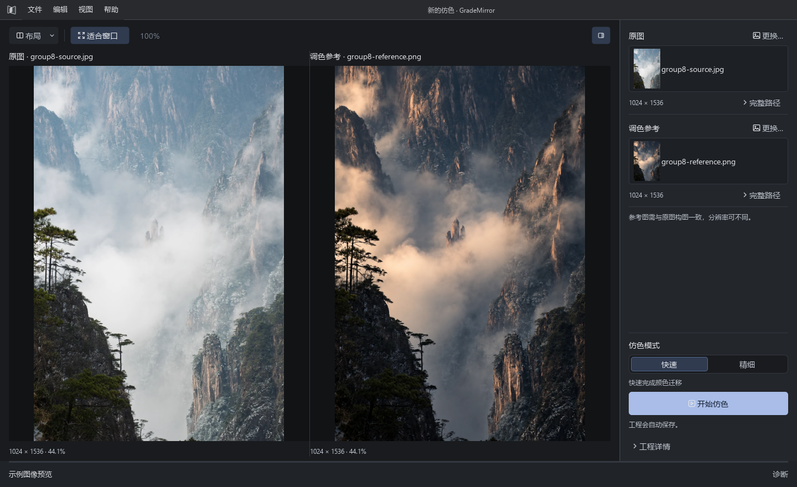
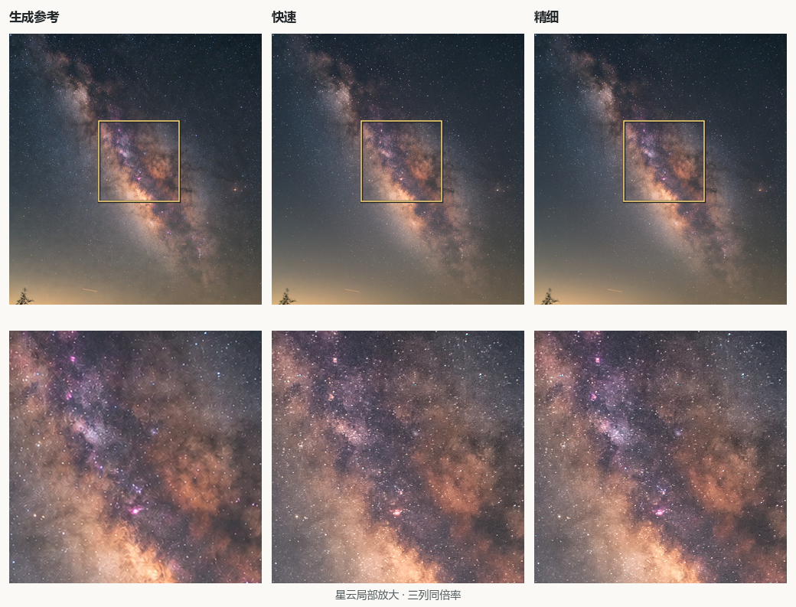
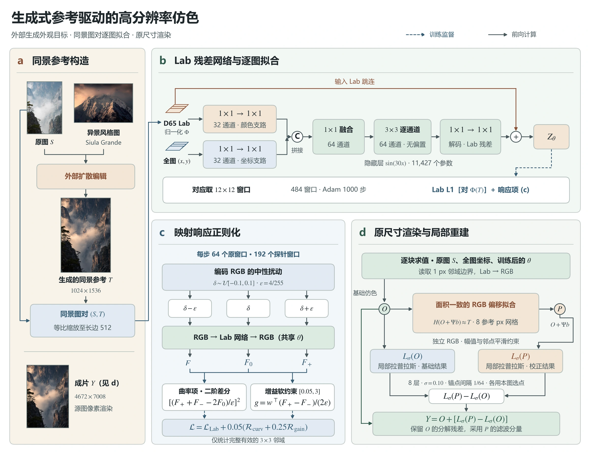

简体中文 · <a href="README.md" lang="en">English</a>

<h1 align="center"></h1>

<strong>把生图模型的调色效果，镜像回原片。</strong>

  <strong>v0.1.0 首次预览版</strong> · Windows x64 · 免费下载 · 程序内版本 <code>0.1.0-preview.50</code>

  <strong><a href="https://pixelcraft2026.github.io/GradeMirror/grademirror.html">网站</a> · <a href="https://pixelcraft2026.github.io/GradeMirror/">研究</a></strong> · <a href="docs/README.zh-CN.md">文档</a>

  <a href="#下载与启动">下载与启动</a> ·
  <a href="#第一次仿色">快速上手</a> ·
  <a href="#快速与精细">快速与精细</a> ·
  <a href="#格式与设备">格式与设备</a> ·
  <a href="#研究与算法">研究与算法</a> ·
  <a href="#源码许可与反馈">源码、许可与反馈</a> ·
  <a href="#支持-grademirror">支持 GradeMirror</a>

GradeMirror 是一款在 Windows 本地运行的参考仿色工具。导入原片和同一场景的调色参考，它会从这一对图学习色彩与局部明暗的变化，再以原片像素为基础，按原尺寸渲染成片。参考可以由外部生图模型制作，也可以是手工调好的小样。准备好图对后，仿色和导出都在本机完成。

随着技术的发展，生图模型在照片调色中展现出了不可思议的潜力。它们具备比几乎所有传统图像处理算法更强大的场景语义理解能力，能够结合主体、材质和光照，为不同区域构思色彩与明暗变化，并协调区域之间的过渡。而相比大语言模型逐项调用曲线、色轮和蒙版，它又可以一次呈现整套局部效果，省去事先拆分区域和逐个指定参数。但目前生图模型的结果存在分辨率低，纹理细节重绘等局限，阻碍了其应用在专业摄影后期创作中。

于是我开发出了GradeMirror， 实现了一套将生图模型的调色迁移至原片的算法，让摄影师们得以在几乎不损失原片分辨率与纹理细节的情况下，将生图模型的强大调色能力应用在他们的照片上。

## 调色效果

上排是 **4672 × 7008 原片、1024 × 1536 生成参考和 4672 × 7008 仿色成片**的网页预览。引线标出右下山峰的取景范围，下排按相同的显示比例放大这处局部，便于比较峰顶的松枝和岩壁纹理，观察参考的色调如何带到原片上。这组图展示的是保存的研究结果。

### 如何准备参考

**以雾中岩峰为例，整个过程用到了三张图。** 上图中列就是 ChatGPT 生成的同景调色稿。

1. **原片决定画面内容。** 把雾中岩峰原片作为第一张图发给 ChatGPT。它提供要保留的构图、视角、山脊与松枝，也是 GradeMirror 最后用来渲染成片的底图。
2. **异景照片提供调色灵感。** 第二张图是摄影师 **Max Rive** 拍摄的一张秘鲁山景，来自他的 [Peru 作品集](https://maxrivephotography.com/pages/peru)。在同一次请求里，请 ChatGPT 保留第一张图的场景，借鉴第二张照片的色调、明暗和冷暖关系，为第一张图生成调色稿。
3. **生成稿是 GradeMirror 的调色参考。** 在软件里，「原图」选雾中岩峰原片，「调色参考」选 ChatGPT 生成的同景稿。GradeMirror 从这一对图学习色彩和局部明暗的变化，再把调色应用到原片像素上。

给 ChatGPT 的提示语可以这样写：

> 请以第一张雾中岩峰照片为底图，保持它的构图、裁切、视角和主体位置。借鉴第二张照片的色调与明暗，让受光岩壁略暖，雾气保留冷暖层次。保持山脊、松枝和岩面的形状与细节，让明暗过渡自然。

选稿时，在两张图之间来回切换，检查山脊、突出岩峰、松枝和裁切边界是否对得上。参考稿的分辨率可以低于原片，构图和对应位置越接近，边缘附近的调色越容易拟合。如果手上已经有同一张原片的手工调色稿，可以直接把它用作调色参考。

**用豆包生成参考。** 豆包也可以按上述步骤生成同景调色稿。使用带豆包水印的参考稿时，水印对快速模式的整体仿色没有明显影响。精细模式会根据参考图补偿局部色差，水印会干扰所在区域的校正。需要使用精细模式时，建议选用无水印的同景稿。

## 下载与启动

GradeMirror v0.1.0 预览版现已发布，支持 Windows x64。

| 设备 | 下载 | 启动 |
|---|---|---|
| CPU | [CPU 便携版](https://github.com/PixelCraft2026/GradeMirror/releases/download/v0.1.0/GradeMirror-0.1.0-Windows-CPU.zip) | 全部解压，在 `GradeMirror-CPU` 内启动 `GradeMirror.exe`。 |
| 兼容 NVIDIA 显卡 | [GPU 第 1 包](https://github.com/PixelCraft2026/GradeMirror/releases/download/v0.1.0/GradeMirror-0.1.0-Windows-GPU-1.zip) ＋ [GPU 第 2 包](https://github.com/PixelCraft2026/GradeMirror/releases/download/v0.1.0/GradeMirror-0.1.0-Windows-GPU-2.zip) | 两包分别全部解压到同一个上级目录，再从合成的 `GradeMirror-GPU` 文件夹启动。 |

两版均随附运行环境，解压后即可启动。GPU 版还需要兼容的 NVIDIA 驱动。下载前请查看适用的组件约定。[下载指南](docs/DOWNLOAD.md) · [发布说明与 SHA-256](docs/RELEASE-v0.1.0.md) · [Microsoft 组件约定](docs/MSVC-RECIPIENT-TERMS.md) · [NVIDIA 组件约定](docs/NVIDIA-RECIPIENT-TERMS.md)

### CPU 版和 GPU 版怎么选

没有兼容 NVIDIA 显卡，或只是偶尔处理照片且可以接受较长的等待时间，选 CPU 版即可。经常处理高像素原片，或计划频繁使用精细模式，有兼容 NVIDIA 显卡时优先选 GPU 版。

下面是开发阶段的单次同机对照。两条路线处理同一张 **2400 万像素**照片（4000 × 6000），CPU 为 **Core i5-12600K（4 线程）**，显卡为 **RTX 3070 Ti（8 GB）**。

| 操作 | CPU | NVIDIA GPU |
|---|---:|---:|
| 首次快速仿色 | 约 9 分 36 秒 | 约 1 分 10 秒 |
| 先快速，再继续精细（两步合计） | 约 24 分 05 秒 | 约 2 分 43 秒 |

计时包含处理、预览、JPEG 导出和结果读回等环节。第二行是快速与精细两次调用的用时之和。这是该配置和图对的开发实测，实际用时会随图像尺寸、硬件和系统负载变化。

## 第一次仿色

用你自己的原片和同一场景的调色参考开始。两张图的长边均须至少 512 像素。

1. 把两张图分别拖入「原图」和「调色参考」，选择「快速」开始。
2. 先在全图视图看岩壁与雾气的冷暖，再切到 1:1 联动查看同一处山脊、岩面纹理和过渡。按需要调整仿色强度。如果局部色差还需要校正，可在兼容的快速工程上继续精细处理。
3. 按原片的尺寸、格式和位深另存。保留 `.grademirror` 工程，之后可使用配方恢复结果。

图为 preview.50 工作台示意。左右两栏用于展示雾中岩峰的原片和同景参考。

## 快速与精细

| 模式 | 什么时候用 | 实际做了什么 |
|---|---|---|
| 快速 | 第一次看整体调色，筛选参考，或已经达到想要的效果 | 在长边 512 像素的配对图上学习变换。结合 Lab 颜色、全图位置和 3 × 3 邻域，按原片尺寸渲染。天空和岩面即使原本颜色接近，也可以有不同的调色幅度。 |
| 精细 | 快速结果已经接近目标，仍想补局部色差 | 从快速结果出发，在参考图尺度估计平滑的 RGB 色差，再用边缘感知差值重建把校正带到原尺寸。优先复查山脊、云雾交界和细小高亮，按照片决定是否使用。 |

**银河案例。** 上排标出银心附近的选区，下排按相同倍率放大三列中的同一片星云。可以比较粉紫色亮斑、右侧的暖色星云和它们之间的尘带。中、右两列分别是保存的基础结果和在它上面加入局部校正与差值重建的结果，对应快速与精细的研究阶段。

## 格式与设备

| 图像格式 | 可用位深（每通道） |
|---|---|
| JPEG / JPG、WebP、BMP | 8 位 RGB |
| PNG、TIFF | 8 位或 16 位 RGB |

- **色彩管理**　使用 sRGB，未标记的 RGB 图像按 sRGB 解释。Adobe RGB、Display P3 等请先转换到 sRGB；带透明通道的图请先转换为不透明 RGB。RAW 请先显影，建议导出 sRGB TIFF16。
- **交付规格**　按原片的像素尺寸、格式和位深输出。导出文件以处理后的画面为主图，ICC 和摄影 EXIF 的保留范围因格式与原文件而异。对元数据有要求时，建议在交付前读回一张结果核对。
- **大图处理**　输入尺寸检查的像素上限是 2.1 亿，实际能否运行取决于画面尺寸、模式、RAM、Windows 可提交内存和空闲显存。早期开发版本 preview.26 曾在 Windows 10 和 RTX 3070 Ti 8 GB 上，复用保存的参数与局部校正系数，完成富士 102 MP TIFF16（11648 × 8736）的原尺寸渲染、导出和读回。preview.50 在 Windows 11 build 26200 已验证两种便携版使用 CPU 完成小图快速仿色，原生 CUDA 路线仍待验证。

安装包决定程序随附哪些运行库，**计算路线**决定每次任务怎样执行。CPU 可承担快速和精细。Auto 优先使用通过检查的 NVIDIA 路线。显存或主机资源不足时，程序会提示检查资源，并在条件允许时提供 CPU 选项。受支持的精细任务还可显式选择 Hybrid，由 NVIDIA 执行模型渲染、CPU 完成精细后处理。已保存配方的恢复也需要匹配兼容路线。

在「帮助 → 设备与运行状态」（Ctrl+Alt+R）可查看设备信息。进度栏会显示当前阶段，数据足够时给出剩余时间区间。[下载指南](docs/DOWNLOAD.md) · [已知限制](docs/KNOWN-ISSUES.md)

## 工程与命令行

`.grademirror` 工程记录素材身份和调色配方。结果还在内存中时，可以切换预览、调强度或多次导出，沿用已完成的计算。结果释放后，重开兼容工程可以用保存的配方重新渲染。原片换了位置，可从「帮助」重新定位，程序会核对文件身份。

在程序目录打开 PowerShell，把示例路径换成你自己的图像路径。以下命令以 JPEG 原片为例，建立快速工程并按 75% 强度导出。

~~~powershell
.\GradeMirror-CLI.exe doctor --json

.\GradeMirror-CLI.exe fit --source ".\photos\original.jpg" --reference ".\photos\reference.webp" `
  --mode fast --backend cpu --out ".\matched.grademirror" `
  --export ".\matched.jpg" --alpha 0.75 --json
~~~

`fit` 为新图对学习调色，`replay` 用已有配方恢复结果。自动化还可用 `plan` 查看路线，用 `result` 子命令对驻留结果预览、导出或释放。各命令支持用 `--help` 查看具体参数。

有了 CLI，LLM 可以串起**挑选原片与风格参考 → 调用外部生图模型制作同景稿 → 调用 GradeMirror 把调色应用到原片并导出**。每一步都可以单独查看输入和结果。基于 GradeMirror 的调色 Skill 正在开发中，敬请期待。

## 研究与算法

论文研究的是构图接近的同景图对。低分辨率调色稿提供目标色彩与明暗，最终结果以高分辨率原片为基础渲染。前期对照纳入了全局颜色映射、BGU、SA-LUT、SM-LUT 等路线。在局部调色较强的开发案例中，带 **3 × 3 邻域**的 [INRetouch](https://arxiv.org/abs/2412.03848) 是视觉表现较好的方法之一，也支持对单一图对拟合并在原尺寸上求值。论文以它联合使用颜色、位置和邻域的思路为起点，在独立实现上发展了以下三个环节。

展开算法流程图与方法说明

1. **Lab 域残差建模。** 在长边 512 像素的图对上，网络分别编码颜色与全图坐标，再用 3 × 3 逐通道卷积引入邻域信息。颜色输入、网络预测的残差和主损失都采用归一化 D65 CIELAB。把预测残差加到输入的 Lab 颜色后转回 RGB。原尺寸渲染时，分块继续使用全图坐标，并跨分块边界读取原片邻域。
2. **映射响应正则化。** 训练时，对部分窗口的编码 RGB 三通道同时加上小幅偏移，比较三点扰动下的预测结果，用有限差分约束响应曲率，并惩罚过低或过高的增益。这个环节约束的是训练中学到的颜色变换，目的是改善相近输入颜色之间的过渡。
3. **局部色彩校正与差值重建。** 精细阶段以原尺寸基础仿色结果 `O` 为起点。把基础结果和候选偏移场按相同的面积规则聚合到参考尺度，拟合一个随位置平滑变化的双线性 RGB 加性偏移场。把它应用到原尺寸得到 `P`，再分别对 `O` 和 `P` 做局部拉普拉斯滤波 `L`，得到 `Y = O + [L(P) − L(O)]`。这一步将校正结果的滤波分量与基础结果的分解残差重新组合。

论文包含 15 个参与过方法选择的开发案例，其中 6 个有完整后处理对照。以基础仿色为基准，单独局部校正使参考尺度的 RGB 平均绝对误差降低 **5.63%–15.45%**。加入差值重建后，六例的误差均较单独校正有所回升，相对基础仿色仍降低 **3.30%–9.75%**。参考图参与了拟合，这些数字衡量的是已有案例上与参考色彩的一致程度。纹理、星点和边缘的表现需要结合原片与结果的同位置对照判断。

## 展望

在有限的几组初步测试中，image2.6 与 GradeMirror 的组合在仿色、单张 JPG 照片的白平衡校正等任务上，表现优于纳入对照的当前先进方法（SOTA），展现出在更多图像处理任务上的潜力。相关的研究正在进行，待取得阶段成果后再释出更多细节。这里主要是 image2.6 的功劳，它负责生成调色或白平衡校正的参考稿。GradeMirror 只在最后补上一步，把参考稿的色彩和明暗迁移回原片，用原片的分辨率和纹理出图，从而弥补 AI 生图的短板。或许在不久的将来，生成模型与专用算法的这种分工会改变许多图像处理问题的求解思路。

## 源码、许可与反馈

> [!IMPORTANT]
> GradeMirror 是一个处于预览阶段的开放项目，行为和接口可能随着开发发生变化。
>
> 如果项目对你有帮助，欢迎在分享基于它的作品时注明 GradeMirror，在学术工作中引用本仓库，或为仓库点星并分享使用体验。
>
> GradeMirror 自有代码以 **AGPL-3.0-only** 许可提供。使用、修改或分发时，请遵守 [AGPL 许可条款](LICENSE)，特别注意：
>
> - **不得以闭源条款分发 AGPL 覆盖的整体作品。** 如果将 GradeMirror 代码与其他代码组合后形成 AGPL 覆盖的作品，向他人分发时，须按 AGPL 为该整体提供许可及相应源码。
> - **不得省略适用的源码和许可义务。** 分发 GradeMirror 或其修改版时，须按许可要求保留版权与许可通知，并以许可规定的方式提供相应源码；修改版还须按许可标明修改。
> - **不得对远程网络交互用户隐瞒修改版的对应源码。** 如果用户通过网络与修改版程序远程交互，须依 AGPL 第 13 条向这些用户提供获取该版本对应源码的机会。
>
> 以上是重点说明，完整条件以 [AGPL 许可原文](LICENSE)为准。如需 AGPL 以外的许可条件，可通过 Issue 联系项目所有者，商议其有权另行授权的部分。第三方组件和品牌素材分别适用其许可或使用条件；详见 [项目通知](docs/NOTICE.zh-CN.md) 和[第三方材料](docs/THIRD-PARTY.md)。

应用源码位于 [`engineering/source/src/grademirror/`](engineering/source/src/grademirror/)。[构建说明](docs/BUILD.md) 列出锁定的依赖和打包入口。[完整源码与第三方材料 ZIP](https://github.com/PixelCraft2026/GradeMirror/releases/download/v0.1.0/GradeMirror-0.1.0-Source-and-ThirdParty.zip) 包含对应工程、第三方源码归档、通知及 Qt 库构建指引。

反馈问题时，请附程序版本、CPU/GPU 版型、Windows 版本及复现步骤。可从「帮助」导出诊断日志，分享前请移除私人路径或照片。[GitHub Issues](https://github.com/PixelCraft2026/GradeMirror/issues)

## 支持 GradeMirror

如果 GradeMirror 对你的摄影后期有帮助，欢迎[请我喝杯咖啡](https://buymeacoffee.com/pixelcraft2026)，支持项目继续开发和维护。
